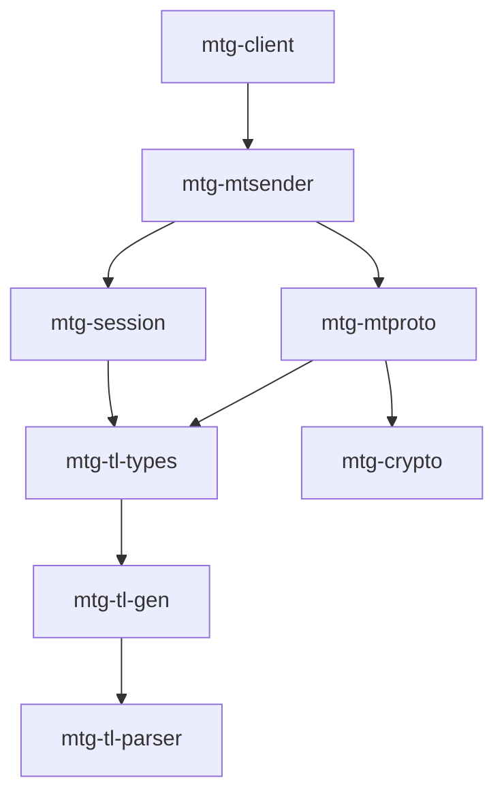

# mtg

Rust crates for Telegram's MTProto API, used by [Ferrogram](https://github.com/ferrogram-app).

## Crates

Arrows point to a dependency; links implied through another crate are left out.

| Crate | What it does |
|---|---|
| [mtg-client](mtg-client/) | High-level API: login, dialogs, messages, files, updates ([examples](mtg-client/examples)) |
| [mtg-mtsender](mtg-mtsender/) | Network connection to Telegram, request/response handling |
| [mtg-session](mtg-session/) | Session storage (DC keys, peers, update state) and the update gap logic |
| [mtg-mtproto](mtg-mtproto/) | [MTProto](https://core.telegram.org/mtproto) messages, transports, key exchange |
| [mtg-crypto](mtg-crypto/) | AES-IGE, RSA, SHA, 2FA (SRP) |
| [mtg-tl-types](mtg-tl-types/) | Rust types generated from the TL schema (layer in `api.tl`) |
| [mtg-tl-gen](mtg-tl-gen/), [mtg-tl-parser](mtg-tl-parser/) | TL code generator and parser |
| [mtg-secret](mtg-secret/), [mtg-calls](mtg-calls/) | Planned: secret chats; call signalling and key exchange |

## Security

Not independently audited. If security is critical for you, review at least `mtg-crypto` and the key
exchange in `mtg-mtproto`.

## License

MIT ([LICENSE-MIT](LICENSE-MIT)) or Apache-2.0 ([LICENSE-APACHE](LICENSE-APACHE)), at your option.
Earlier copyright notices are kept in the license files and in the source file headers.
